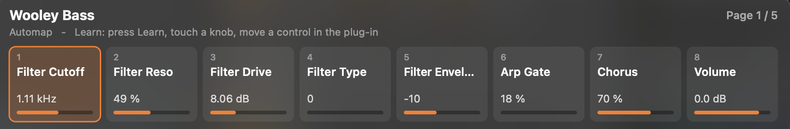

# Nocturn Automap for Apple Silicon

A native 64-bit replacement for **Novation Automap** and the **Novation Nocturn** driver on modern Macs (Apple Silicon and Intel,
macOS 12+). Novation's software is 32-bit and stopped working with macOS Catalina; this project rebuilds what it did from scratch,
so the Nocturn works again, with Ableton Live in particular.



| part | what it does |
|---|---|
| **NocturnBridge** (`bridge/`) | User-space USB driver. Talks to the Nocturn directly (no kernel extension) and presents it as MIDI ports called **Nocturn**. Also draws the Automap-style **HUD** and puts a dial icon in the menu bar. |
| **Live remote script** (`live-script/`) | Native Automap for Ableton Live 11/12. The Nocturn controls whichever device is selected (Live devices, VST, AU) with pages of 8, learn, mappings saved per plug-in, LED-ring feedback, and a mixer mode. **No wrapper plug-in needed.** |
| **Wrapper plug-ins** (`wrapper/`, optional) | AU/VST3 wrappers that host another plug-in and map all its parameters to the Nocturn: for other DAWs, or plug-ins with more than 128 parameters. |

## Install
Requires the Xcode Command Line Tools (`xcode-select --install`).
```sh
git clone https://github.com/<you>/nocturn-automap.git
cd nocturn-automap
sh install.sh                  # driver + Live script
sh install.sh --with-wrapper   # optional: also the AU/VST3 wrapper plug-ins (needs: brew install cmake)
```
Then:
1. Uninstall the old Novation Automap and USB driver if they're still installed.
2. Start the driver with `~/Applications/NocturnBridge/NocturnBridge`. A dial icon appears in the menu bar and the HUD shows briefly.
3. In **Ableton Live**, open Settings → Link, Tempo & MIDI and set Control Surface **Nocturn**, Input **Nocturn**, Output **Nocturn**.
   For the Nocturn ports, turn Track and Sync **off**.

## Using it in Live
Select any device and the Nocturn takes it over. Live devices start with Live's own key controls, and plug-ins get all their parameters in order.

| Nocturn | Automap mode (default) | Mixer mode |
|---|---|---|
| Encoders 1–8 | the 8 parameters on the current page | volumes of the 8 tracks in the red box |
| Encoder touch | shows the parameter in the HUD; picks the knob for Learn | shows the track in the HUD |
| Speed dial | fine-adjust the last touched parameter | select track |
| Crossfader | learned parameter for this device, otherwise Live's crossfader | Live's crossfader |
| Buttons 1–8 | jump to page 1–8 | mute tracks |
| **Learn** | press, touch a knob (or move the crossfader), then move a control in the plug-in's window. **Hold 1.5 s** to reset the device's mapping | – |
| View | reset the last touched parameter to its default | – |
| Page − / + | previous / next page | move the red box |
| User / FX | previous / next device on the track | |
| Inst | lock to this device | |
| Mixer | switch Automap ↔ Mixer | |

Learned layouts are saved per plug-in in `~/Music/Ableton/User Library/Remote Scripts/Nocturn/mappings/`.

**Plug-ins with more than 128 parameters** (e.g. Massive X, Serum): Live doesn't expose their parameters automatically.
Click **Configure** on the device in Live and move the controls you want, and they appear on the Nocturn and in the HUD.

### The HUD
A floating panel (pictured at the top of this page) showing the device, page, and the name, value and position of all 8 knobs (plus a learned crossfader).
The touched knob is highlighted and the learn target is shown in red. It pops up on touch, page change, device change or
Learn, then fades. Drag it anywhere and it remembers the position. The menu-bar dial icon sets it to *show when touched*,
*always visible* or *off*.

## NocturnBridge options
| flag | |
|---|---|
| `-c N` | MIDI channel 1–16 |
| `-A` | plain MIDI mode: absolute 0–127 encoders with local LED rings (generic controller, no Live script) |
| `-t` | buttons toggle on/off |
| `-a` | no encoder acceleration |
| `-H` | no HUD or menu-bar icon |
| `-v` | log all USB and MIDI traffic |

**Start at login:** edit the path in `bridge/com.user.nocturnbridge.plist`, then
`cp bridge/com.user.nocturnbridge.plist ~/Library/LaunchAgents/ && launchctl load ~/Library/LaunchAgents/com.user.nocturnbridge.plist`.

## Troubleshooting
- **Knobs work but there's no HUD, or the Live script seems ignored.** An old Novation install leaves a folder called `Nocturn` in
  `~/Library/Preferences/Ableton/Live <version>/User Remote Scripts/`. Live loads that one instead of this script.
  Move it out of that folder and restart Live. `install.sh` warns if it finds one.
- **Script diagnostics.** The Live script writes `nocturn_debug.log` next to itself (startup steps, errors, first HUD message).
- **Driver diagnostics.** Run `NocturnBridge -v` to see every USB packet and MIDI message.
- **"device is held by another process"** means an old Novation driver is still installed. Remove it and reboot.

## Tests
```sh
cc -o test_core tests/test_core.c && ./test_core   # USB protocol core
python3 tests/test_live_script.py                   # Live script against a mock of Live's API
```
CI builds the bridge and the wrapper and runs both test suites on macOS (`.github/workflows/ci.yml`).

## How it works
See [docs/PROTOCOL.md](docs/PROTOCOL.md) for the Nocturn USB protocol, the MIDI map, and the SysEx used between the Live
script, the wrapper and NocturnBridge.

## Disclaimer
Novation, Nocturn and Automap are trademarks of Focusrite Audio Engineering Ltd. This project is not affiliated with or endorsed by
Novation or Focusrite. It contains no Novation code or files; the USB protocol was documented for interoperability with hardware
you own. Ableton and Live are trademarks of Ableton AG.

## Licence
[Apache License 2.0](LICENSE). See [NOTICE](NOTICE). The optional `wrapper/` links JUCE (AGPLv3/commercial), so binaries built
from it follow JUCE's terms. See [wrapper/README.md](wrapper/README.md).
